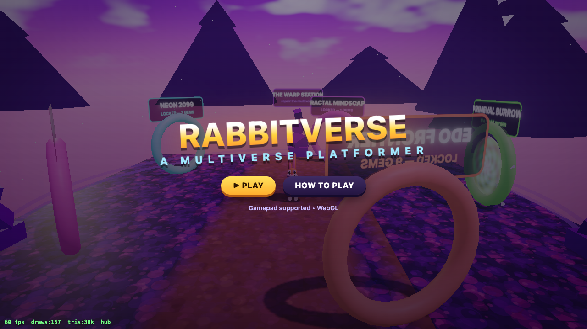

# 🐰 RABBITVERSE — a multiverse mascot platformer (Three.js / WebGL)

An original AAA-style third-person 3D platformer vertical slice, built with Three.js.
Benchmark target: *Crash Bandicoot: Warped* / *Crash 4: It's About Time* game feel.



## Play

```bash
npm install
npm run dev        # → http://localhost:5210
```

Any modern browser. Keyboard + gamepad supported.

**Debug / unlock-all:** open `http://localhost:5210/?unlock=1` — grants every gem and opens
all five world doors. Add `&debug=1` for the fps/draw-call overlay.

## Controls

| Action | Keyboard | Gamepad |
|---|---|---|
| Move | WASD / Arrows | Left stick |
| Jump (hold = higher, again = double jump) | Space | A / Cross |
| Spin attack | J / X | X / Square |
| Slide (while running) | K / C / Shift | B / Circle |
| Body Slam (in air) | K / C | B / Circle |
| Camera | Q / E | Right stick |
| Pause | Esc / P | Start |

## The Warp Station + 5 Worlds × 5 Levels

Reaching the exit portal awards the level's **Reality Gem** automatically → gems unlock new
worlds (Crash Warped rules). Door signs show live progress (`2/5 ▶ FERN GULLY`). Progress
auto-saves to localStorage.

| World | Theme | Unlocks at |
|---|---|---|
| W1 PRIMEVAL BURROW | the rabbit garden (contains the original vertical slice) | open |
| W2 FRACTAL MINDSCAPE | psychedelic mandelbrot dreamscape | 1 gem |
| W3 NEON 2099 | futuristic rooftop city | 3 gems |
| W4 TROPIC PLASMA | tropical neon jungle | 6 gems |
| W5 EDO FRONTIER | feudal Edo × Old West moonlight | 9 gems |

Each world has 5 long multi-part levels (5+ distinct sections each) built from the section
grammar: turns, 2.5D shelves, boulder chases, time-slow collapse rooms, spinner gauntlets,
pendulum ridges, gap chains, ascending/descending staircases, enemy encounters along the
whole route — and **a unique villain boss closing every level** (24 bosses).

Boss roster (all original): MOSSJAW / THE GARDENER (garden), PRISM WIDOW / THE RECURSOR
(fractal), GRIDWARDEN / OVERLORD.EXE (neon), EMBER DUCHESS / THE CONFLAGRATION (tropic),
RONIN FROSTBITE / THE FROST SHOGUN (edo) — each with attack mixes: shockwave rings,
reflectable seeds, telegraphed charges, icicle rain, sweep beams, minion summons —
plus the flagship KING SNARLTOOTH in w1-1.

Hazards & enemies vocabulary: falling icicles (telegraphed), timed fire jets, track saws,
spiked spinner bars, pendulum logs, collapsing platforms, moving platforms — plus Snarlrats,
Spikebacks, Darterflies, Spitter Plants, **Chargers** (baitable bull beetles) and **Divebats**.

## The Vertical Slice — "PRIMEVAL BURROW"

One handcrafted level demonstrating the full production bar:

- **Clearing** — movement teaching, first crates, carrot trails
- **Jungle Lane** — gaps, patrol enemies, bounce crates, TNT/nitro chain reactions
- **Secret route** — arrow-crate launch to a hidden Dimension Shard ledge
- **Side-scroll cliff** — 2.5D camera, moving platforms, canyon gate
- **Time Ruins** — **TIME SLOW Reality Power**, collapsing bridge, spinner gauntlet
- **Boulder chase** — camera flip, run-toward-camera escape
- **Boss Arena** — **KING SNARLTOOTH**, a 3-phase carnivorous plant (shockwave slams,
  reflectable seed spits, vulnerability windows), Reality Gem reward, dimensional portal outro

## Feature checklist (per `docs/prompt.md`)

- Character controller: coyote time, jump buffering, variable jump height, double jump,
  slide, slide-jump, body slam, spin (with aerial float), knockback, i-frames,
  moving-platform carry, step-up assist, camera-relative movement
- Rabbit: fully procedural model + rig, spring-driven ears, squash & stretch, blink,
  pupil tracking, expressions, spin-tornado smear, run/idle/jump/fall/slide/slam poses
- Camera: follow / side-2.5D / chase / boss modes, velocity lookahead, auto-recenter,
  occlusion pull-in, dynamic FOV, impulse shake
- Crates: normal, carrot, bounce(×10), TNT (countdown + chain), nitro, slam-only, iron,
  arrow-spring, checkpoint, life — pooled debris, dust, shockwaves, crate-total tracking
- Collectibles: instanced dimensional carrots (magnet + pickup-chain pitch), Reality Gem,
  Dimension Shard, time crystal, 1UPs (100 carrots)
- Enemies: Snarlrat (patrol), Spikeback (slam-only), Darterfly (bounce target),
  Spitter Plant (reflectable projectiles)
- Hazards: pendulum log, rotating spiked bars (time-slowable)
- World: procedural painted textures, world-space UVs, instanced foliage w/ wind,
  animated ocean + waterfalls, procedural sky, snow-capped vista, dino-bone arch
- FX: pooled particle system, wood-chip debris pool, shockwave rings, portal swirl shader,
  bloom + grade + vignette post chain (UnrealBloomPass)
- Audio: 100% synthesized WebAudio — full SFX vocabulary + adaptive procedural music
  (level / chase / boss / title modes), pickup-chain pitch ladder
- Systems: checkpoints (zone + crate), platform state reset on respawn, lives/game-over,
  results screen with gem objectives (all crates / no deaths / boss gem), pause, title
- QA agents: headless screenshot critic loops (`npm run qa`), portrait/action captures,
  and an **autopilot bot that actually plays the game** (per-section + full-run validation)

## QA tooling

```bash
node qa/smoke.mjs                 # plays EVERY level via rail-anchor bot → verdicts
node qa/hazshots.mjs              # new hazards/enemies in action
node qa/bossfight.mjs             # all five boss archetypes fighting
node qa/flowtest.mjs              # beat-level → hub → door progression flow
node qa/worldshots.mjs            # hub + world theme screenshots
node qa/screenshot.mjs            # primeval visual critic sweep
node qa/portrait.mjs              # rabbit closeups
node qa/playthrough.mjs full      # primeval section autopilot (lane/side/ruins/chase/boss/full)
```

Debug overlay: append `?debug=1` (fps, draw calls, tris). QA hooks: `window.__qa`.

## Architecture

```
src/
  core/    Input, AudioBus (synth SFX + adaptive music), Progress (save/unlocks)
  render/  Stage (lights/sky/fog/shadows), Post (bloom/grade/vignette)
  player/  RabbitV2 (bendy-ear rubber-hose rig; V1 saved in Rabbit.js),
           Controller (platforming physics), CameraRail (authored camera rails)
  world/   Level (collision world, painted textures), Themes, LevelKit (section
           grammar), recipes.js (hub + 24 levels), Runtime (build/teardown),
           Crates, Collectibles, Enemies, Hazards, Deco, Water, Portal, Boss,
           levels/primeval.js (the flagship level)
  fx/      Particles (pooled points + debris + shockwaves)
  ui/      HUD + screens
qa/        headless agent suite (smoke bots + screenshot critics + flow tests)
```

## Roadmap

Per-world bosses, relics/time-trials, costumes, ability-gated secrets, more Reality
Powers (gravity/phase/elasticity/scale/clone), deeper psychedelic fractal shaders.

## License

Code: MIT (see `LICENSE`). Original procedural assets: CC BY 4.0 (see
`ASSET-LICENSE.md`). Third-party components: see `THIRD_PARTY.md`.
